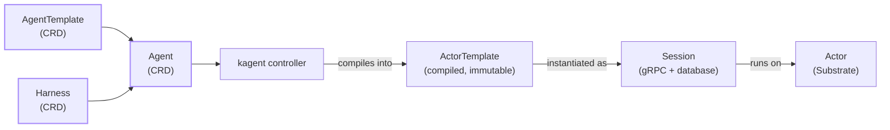

## kagent 1.0

 1.0 replaces 0.x's Deployment-based `Agent` custom resource with a new model built around **Harness**, **AgentTemplate**, **Agent**, and **Session**. The 1.0 `Agent` kind keeps the 0.x name but not its meaning, because it pairs an AgentTemplate with a Harness rather than describing a Deployment. This page defines the vocabulary that the rest of the 1.0 documentation uses.

> [!NOTE]
> Moving a 0.x installation to 1.0 is a manual migration, and no upgrade path exists. No controller converts a 0.x resource, and the two API groups share no conversion, so you author the 1.0 resources yourself and retire the 0.x ones. [Migrate from 0.x]() maps each 0.x resource onto its 1.0 replacement.

The new model separates what an agent can do from how it is allowed to run, and then names the pairing explicitly:

- A [**Harness**](#harness) defines how an agent is allowed to run. It picks a runtime and the infrastructure policy around it.
- An [**AgentTemplate**](#agenttemplate) defines what an agent can do: its model, prompt, and tools.
- An [**Agent**](#agent) pairs one AgentTemplate with one Harness. Callers address the Agent, and the controller compiles it.
- A [**Session**](#session) is a running conversation with an Agent.
- An [**Actor**](#actor) is the sandboxed process, provided by Substrate, that a Session runs on.

Agents do not run as Kubernetes Deployments. kagent runs every Session on [Agent Substrate](), a compute layer that starts capacity in advance and places sandboxed workloads onto it. An idle Actor is suspended to a snapshot and restored when the next message arrives, and a caller never sees the pause.

Agent Substrate needs its own definition of the workload to run, so the kagent controller compiles each Agent into an **ActorTemplate**, the Substrate resource that an Actor is created from.

The following diagram shows how an Agent becomes a running conversation.
</br></br>



An operator applies the three custom resources directly. The kagent controller watches each Agent, resolves the template and harness that it names, and compiles the result into an ActorTemplate. From there, each Session created against that Agent gets its own Actor to run on.

> [!IMPORTANT]
> All three resources belong to the `api.kagent.dev` API group, which keeps them separate from the `kagent.dev` resources that 0.x serves, including 0.x's own `Agent` kind. The two groups share no conversion. On a cluster that serves both, qualify the resource name as `kubectl get agents.api.kagent.dev` to select the 1.0 API.

## Harness

<!-- REVIEW (docs): the reviewer asked for an established industry definition of "agent harness" with a source. The definition below is drawn from what the linked harnesses do rather than from a published definition. Replace it with an approved citation, or confirm that the examples are sufficient sourcing. -->

An agent harness is the application layer that executes an agent and adds capabilities around its model. It typically assembles context, invokes the model, executes tool calls, loads skills, feeds results back into the agent loop, and manages session state. A harness can also provide memory, subagents, permissions, approvals, sandboxing, and event streaming.

Examples include [Claude Code](https://code.claude.com/docs/en/how-claude-code-works), [Codex CLI](https://learn.chatgpt.com/docs/codex/cli), [Gemini CLI](https://geminicli.com/docs/), [OpenClaw](https://docs.openclaw.ai/concepts/agent-runtimes), and custom in-house applications. Each of those runs on a local machine with your own shell and files.

A **Harness** in kagent is a Kubernetes custom resource that applies that idea to a cluster. It defines _how an agent is allowed to run_, and specifies:

- **Runtime**: The engine that executes the agent. A Harness selects exactly one of `kagent`, `codex`, `claude`, or `byo`, and kagent compiles all four. `kagent` runs kagent's own agent engine, `codex` and `claude` run those coding agents, and `byo` runs any image that implements kagent's A2A contract.
- **Workload**: The container image, command, and arguments that the runtime runs as.
- **Environment**: Literal environment values for the runtime, set in `spec.env`.
- **Substrate policy**: The capacity that the agent runs on, and where its state is kept when it goes idle. The Harness names a [WorkerPool]() to schedule onto and the storage location that snapshots write to.

A Harness names no AgentTemplate, and an AgentTemplate names no Harness. An [Agent](#agent) pairs the two, and nothing pairs them implicitly. Applying a Harness runs nothing on its own. It registers a runtime and policy that an Agent can select.

Each runtime accepts a different subset of configuration, and an Agent that asks for something its runtime cannot do reports a compatibility condition rather than running. For the per-runtime restrictions and the complete Harness schema, see the [API reference]().

> [!IMPORTANT]
> This `Harness` is unrelated to 0.x's `AgentHarness` resource, which provisions OpenClaw or Hermes coding-agent sandboxes. `Harness` is a different resource that covers how any agent is allowed to run, not a renamed or expanded version of `AgentHarness`.

## AgentTemplate

An **AgentTemplate** is a Kubernetes custom resource that defines _what an agent does_. It specifies:

- **Model configuration**: The large language model (LLM) provider and model the agent uses.
- **System prompt**: A literal prompt, or a Go-templated one that can include shared ConfigMaps.
- **Tools**: A list of tool bindings that the agent can call. Each binding is either a Model Context Protocol (MCP) server, or another AgentTemplate used as a subagent tool (see [Subagent tools](#subagent-tools)).
- **Skills** and **plugins**: Reusable capability packages, sourced from an Open Container Initiative (OCI) registry, Git, or S3.

An AgentTemplate does nothing on its own. It becomes runnable once an Agent pairs it with a Harness. One AgentTemplate can serve many Agents, so expect fewer templates than Agents where several runtimes run the same behavior.

For the complete AgentTemplate schema, see the [API reference]().

## Agent

An **Agent** is a Kubernetes custom resource that pairs _one AgentTemplate with one Harness_. Both sides are required. Under `spec.template`, the Agent sets exactly one of `ref`, which names an existing AgentTemplate, or `inline`, which carries a complete template spec. Under `spec.harnessRef`, the Agent names an existing Harness. A Harness has no inline form.

An inline template is a complete definition rather than an override of a named AgentTemplate, and kagent creates no Kubernetes resource to back one. Every name resolves in the Agent's own namespace, including a name nested inside an inline template. For the fields that express each choice, see the [API reference]().

The following Agent resource references both sides:

```yaml
apiVersion: api.kagent.dev/v1alpha3
kind: Agent
metadata:
  name: assistant
  namespace: kagent
spec:
  template:
    ref:
      name: shared-context
  harnessRef:
    name: kagent
```

The Agent owns readiness. Its status reports the desired revision, the latest revision that compiled and prepared successfully, any non-blocking compatibility warnings, and the `Accepted`, `ResolvedRefs`, `Compatible`, and `Ready` conditions. An AgentTemplate and a Harness are shared configuration and report no runtime status of their own.

Deleting an Agent retires its definition. Existing Sessions keep the revisions that they pinned. Recreating an Agent under the same name creates a new identity, which cannot inherit the deleted Agent's last successful revision.

For the complete Agent schema, see the [API reference]().

## Session

A **Session** is a _running conversation with one Agent_. Unlike the Harness, AgentTemplate, and Agent that it is built from, a Session is not a Kubernetes custom resource and does not live in etcd. kagent's own gRPC API creates it, and kagent's PostgreSQL database tracks it.



Each compile produces one **revision**, identified by a digest, which is a SHA-256 hash of the compiled configuration. Because that digest is derived from the configuration itself, editing an Agent or either resource it references compiles to a different digest, and therefore becomes a separate ActorTemplate. kagent never rewrites an existing one.

That immutability keeps running Sessions stable. When you create a Session, kagent looks up the Agent's latest successful revision and creates an Actor from it. Editing the Agent afterward does not move that Session, so only Sessions created after the edit use the new revision.

You can create a Session with the following command:

```bash
kagent agent session create --agent assistant -n kagent
```

After it is created, a Session talks to callers over the A2A (Agent-to-Agent) protocol, through kagent's A2A gateway. Callers address the Agent rather than the Session. The HTTP endpoint is `/agents/{namespace}/{name}` and gRPC carries the same `namespace/name` in the standard A2A `tenant` field. The Session's ID is the A2A `contextId`, so a message that carries no context identifier starts a new conversation, and a message that repeats one continues that conversation.

An expiration worker deletes a Session that records no task activity for seven days. The `config.sessions.idleTtl` Helm value sets that window. A value of `0s` turns the expiration worker off. For more information about what the deletion retains, see [Expire idle Sessions]().

## Actor

An **Actor** is the sandboxed unit of compute, provided by [Agent Substrate](), that _runs a Session's conversation loop_. Every Session is backed by an Actor.

An Actor lets a Session suspend and resume cheaply instead of staying resident. To understand the Workers and WorkerPools that Actors run on, see [Agent Substrate architecture]().

## Compute, identity, and isolation

The Harness, AgentTemplate, and Agent resources describe what an agent is. The Actor behind each Session decides how that agent runs. An Actor supplies the agent's compute, its network identity, and the sandbox that confines it.

### Compute

An Actor occupies a slot on a Worker, which is a pre-started pod in a WorkerPool. A Worker hosts many Actors at once, and an Actor that goes idle is suspended to a snapshot so that its slot returns to the pool. A pool therefore serves far more Sessions than it has Workers. Agent Substrate also pauses an Actor to a node-local snapshot, and resumes an Actor onto whichever Worker has room. For these operations and what each snapshot keeps, see [Suspend and resume]().

> [!NOTE]
> Forking a checkpoint into a second Session is unavailable in this release. kagent captures process memory in every snapshot, and a restored copy would hold the source Session's identifiers, so `ForkSession` rejects the request. Forking returns once Agent Substrate separates the pause and suspend snapshot scopes again.

### Identity

Each Actor has its own cryptographic identity, issued as a certificate and scoped to the atespace that it belongs to. Agent Substrate's egress gateway authorizes every outbound connection against the identity on the certificate rather than against anything in the request. Because of this, an agent cannot reach a destination by claiming to be another agent.

This identity also keeps API keys out of the agent. An agent sends a placeholder header, and the gateway replaces it with the real credential as the request passes through, so the key never enters the agent's environment or its filesystem. For the allowlist that the gateway enforces and how credentials are attached to it, see [Egress control]().

### Isolation

Each Actor runs in its own sandbox, with its own filesystem and its own durable volume for application data. Two Sessions on the same Agent share no files and cannot see any of each other's state, even when they run on the same Worker. The sandbox also isolates the workload's system calls from the node's kernel, which matters because an agent runs commands that a model chose. For what each sandbox class separates, see [Sandboxing]().

<!-- REVIEW (docs): the reviewer asked for this page to be reorganized around compute, identity, and sandboxing, and to cover MCP servers, CLIs, file systems, skills, prompts, plugins, and the lifecycle operations. This section adds the three axes and links to the runtime pages that own each mechanism, rather than restating them here. Confirm whether the reviewer wants the kagent resource model reordered under these three headings instead. -->

## Subagent tools

An agent tool binding can point at another AgentTemplate instead of an MCP server, so a broad-scope agent can hand part of a task to a specialist. For example, a release agent delegates a database question to another agent, gets the answer, and carries on. The specialist keeps its own prompt and its own tools, and the conversation stays with the agent that the caller addressed.

Each subagent binding sets `tools[].subAgent.templateRef` to name an AgentTemplate in the same namespace. The named template compiles under the parent Agent's Harness and runs inside the parent's Actor, so the two agents share one sandbox and the nesting creates no second Actor. A subagent needs no Agent of its own and no matching Harness reference.

Because a subagent runs inside its parent's runtime boundary, nesting stops at one level, and a bound template cannot bind a third. Every agent therefore runs either in its own Actor or in the Actor of the agent that bound it, never deeper. For the remaining rules that a tree must satisfy, see [What a subagent tree allows]().

> [!NOTE]
> Dedicated subagents, which would give a bound agent its own Harness, Session, and Actor and reach it over A2A, are not part of the served API. The `subAgent.agentRef` field that would select one is deferred until a dedicated subagent can create and invoke its own Session.
