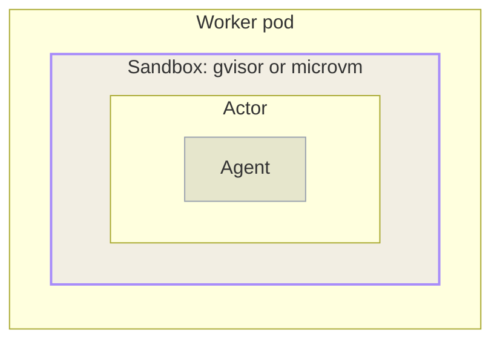

An agent runs an **agentic loop**. A model proposes the next step, the agent carries it out by running a command or calling a tool, and the result feeds the model's next decision. The loop repeats until the task finishes or the agent stops to wait on input from a person.

kagent runs an agent's loop inside an **Actor**, a unit of compute that [Agent Substrate]() creates and manages. An Actor is not an ordinary container process. Each Actor runs inside its own **sandbox**, and one Worker hosts many of those sandboxed Actors at the same time.

This page explains what selects a sandbox, what the sandbox separates, and how traffic reaches an Actor through it.
</br></br>



## Sandbox classes

A **sandbox class** is the sandbox runtime family that a Worker uses. Agent Substrate supports two.

- **`gvisor`** (default): Runs the workload against a [gVisor](https://gvisor.dev) user-space kernel, which keeps the workload's system calls from reaching the host kernel.
- **`microvm`**: Runs the workload inside a lightweight virtual machine, which places a hypervisor boundary between the workload and the host.

A WorkerPool's `sandboxClass` field sets the sandbox class for its Workers, and defaults to `gvisor`. That value does more than name a runtime. Agent Substrate builds the pool's Worker pods to match it, mounting the virtualization devices that a micro-VM needs and placing those pods on nodes that provide them.

> [!NOTE]
> kagent copies a pool's sandbox class onto every ActorTemplate that it generates for that pool. Each template then names the SandboxConfig that serves its class. A `gvisor` template names `gvisor-default`, and a `microvm` template names `microvm`.

## Sandbox configuration

A **SandboxConfig** is a cluster-scoped resource that describes the runtime files a sandbox class requires to start. The resource stores none of those files. Instead, it records the location that the node agent fetches each file from, keyed by processor architecture. It also names the pause image, which holds the sandbox's namespaces as its root container.

Every ActorTemplate must name a SandboxConfig, and Agent Substrate supplies no name of its own. A template cannot be prepared until the configuration that it names exists in the cluster. Many ActorTemplates can share one SandboxConfig. The runtime version is then pinned in a single place, rather than repeated on every template.

A default installation creates one SandboxConfig, named `gvisor-default`. kagent writes that name onto every ActorTemplate that it generates, so each template carries it explicitly. The configuration looks like the following:

```yaml
apiVersion: ate.dev/v1alpha1
kind: SandboxConfig
metadata:
  name: gvisor-default
spec:
  sandboxClass: gvisor
  pauseImage: registry.k8s.io/pause:3.10.2@sha256:<digest>
  assets:
    amd64:
      gvisor:
        url: gs://gvisor/releases/release/20260803/x86_64/gvisor.tar.bz2
        sha256: <sha256>
    arm64:
      gvisor:
        url: gs://gvisor/releases/release/20260803/aarch64/gvisor.tar.bz2
        sha256: <sha256>
```

| Field | Description |
| ----- | ----------- |
| `sandboxClass` | The sandbox runtime family that this configuration applies to, `gvisor` or `microvm`. An ActorTemplate only uses configurations whose class matches its own, and preparation fails if the two disagree. |
| `pauseImage` | The image for the root sandbox container, which holds the sandbox's namespaces and runs no workload code. It must be pinned to a digest, because the snapshot manifest records it, and changing the image invalidates the snapshots that were taken with it. |
| `assets` | The files that the node agent fetches, keyed first by processor architecture and then by asset name. A `gvisor` class expects one `gvisor` asset, the release archive that the node agent extracts. A `microvm` class expects several, such as `cloud-hypervisor`, `kata-kernel`, and `kata-image`. |
| `assets.<arch>.<name>.sha256` | The lowercase hex digest of the file. The node agent verifies each download against it, and caches the result under a path that includes the digest, so changing the digest fetches the new asset instead of reusing the cached one. To read the configuration that your own cluster installed, including the pinned digests, run `kubectl get sandboxconfig gvisor-default -o yaml`.|

## What the sandbox separates

The sandbox draws a boundary in three places.

- **Process and kernel**: The Actor's processes run against the sandbox runtime rather than the Worker node's kernel. A system call that the workload makes is handled by gVisor's user-space kernel, or by the guest kernel inside a micro-VM, instead of reaching the host directly.
- **Filesystem**: The Actor sees the filesystem assembled from its container image, plus whatever durable volume its ActorTemplate declares. Writes to the root filesystem are a layer on top of the image, captured in a `Full` snapshot and discarded by a `Data` one. For what each scope keeps, see [Suspend and resume]().
- **Network**: The Actor does not share the Worker pod's network position. The node agent gives the active Actor a private, point-to-point virtual network inside the Worker pod, so reaching the Actor means going through Agent Substrate's own network path rather than connecting to the Worker directly.

## How traffic reaches a sandboxed Actor

Every Actor is addressed by its atespace and name, at `<actor-name>.<atespace>.actors.resources.substrate.ate.dev`. Reaching it involves several hops, and each one keeps a sandboxed Actor addressable without exposing the Worker that it happens to be running on.

1. Agent Substrate runs its own Domain Name System (DNS) service that answers queries for that address pattern with the address of the router, rather than any individual Worker.
2. The router reads the Actor name and atespace from the request, asks the Agent Substrate API to resume that Actor and report which Worker it is now assigned to, then selects that Worker as the destination.
3. The router connects to a listener on the Worker over mutual Transport Layer Security (mTLS). The listener validates that the caller is the router, and forwards traffic only to the Actor currently assigned to that Worker.

Because the router resolves the Worker assignment on every request, an Actor keeps a stable address across suspends, resumes, and moves between Workers.

A kagent user never uses that address. A message sent to a Session through the kagent API or the web console reaches the kagent controller, which resolves the Session to its Actor and passes the request to Agent Substrate. Every hop after that stays inside the runtime.

Traffic in the other direction leaves through a separate egress gateway rather than going straight out from the Worker. Routing Actor egress through one gateway provides a single place to apply outbound controls.

## Default network posture

Agent Substrate creates a Kubernetes NetworkPolicy for each WorkerPool, selecting that pool's Worker pods. The policy restricts **ingress** to the Agent Substrate router alone. No other pod in the cluster can open a connection to a Worker, so an Actor is not reachable by anything that bypasses the routing path.

That policy governs inbound traffic only. Outbound traffic is governed separately by an egress policy that the gateway enforces on every connection that an Actor opens. That policy is default-deny. An Actor reaches a destination only when a rule allows it, and the gateway denies the connection when no rule does.

kagent derives the egress policy from the AgentTemplate, so an agent carries no egress configuration of its own. The destinations it allows come from what the AgentTemplate already names, such as its model provider and its MCP servers. You author neither policy. Agent Substrate owns the ingress policy, and kagent regenerates the egress policy whenever the AgentTemplate changes. For what the policy holds, how a rule is matched, and how to diagnose a denied request, see [Egress control]().

<!-- REVIEW (egress API owner): whether a user can add a destination that the AgentTemplate does not name is unconfirmed, so this section claims no explicit allowlist either way. Confirm current and planned support before stating one. -->
