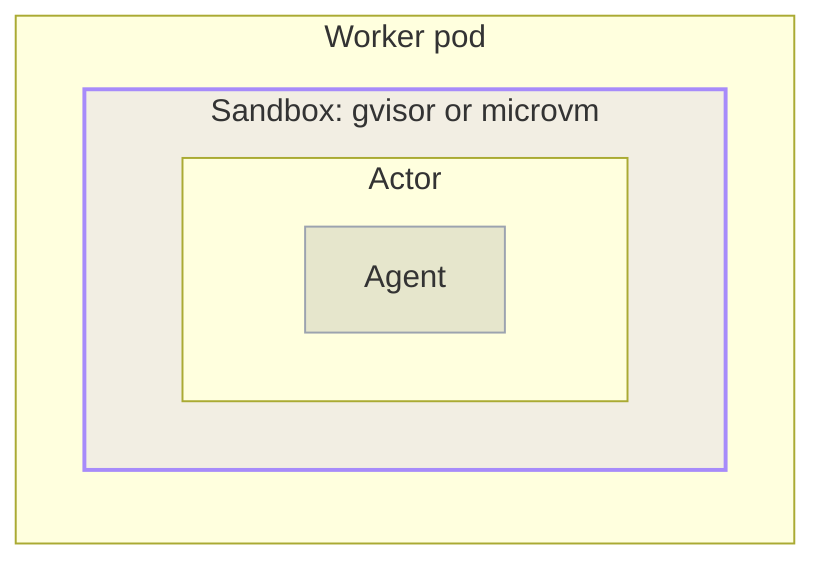

An agent runs an **agentic loop**. A model proposes the next step, the agent carries it out by running a command or calling a tool, and the result feeds the model's next decision. The loop repeats until the task finishes or the agent stops to wait on input from a person.

kagent runs an agent's loop inside an **Actor**, a unit of compute that [Agent Substrate]() creates and manages. An Actor is not an ordinary container process. Each Actor runs inside its own **sandbox**, and one Worker hosts many of those sandboxed Actors at the same time.

This page explains what selects a sandbox, what the sandbox separates, and how traffic reaches an Actor through it.
</br></br>



## Sandbox classes

A **sandbox class** is the sandbox runtime family that a Worker uses. Agent Substrate supports two.

- **`gvisor`** (default): Runs the workload against a [gVisor](https://gvisor.dev) user-space kernel. The user-space kernel keeps the workload's system calls from reaching the host kernel.
- **`microvm`**: Runs the workload inside a lightweight virtual machine. A hypervisor boundary separates the workload from the host.

A WorkerPool's `sandboxClasses` list sets the sandbox class for its Workers. Each entry names a class and, optionally, the SandboxConfig that serves it. The kagent Helm chart creates the default pool with one `gvisor` entry. Each class does more than name a runtime. Agent Substrate builds the pool's Worker pods to match it, mounting the virtualization devices that a micro-VM needs and placing those pods on nodes that provide them.

> [!NOTE]
> kagent copies the class of a pool's first `sandboxClasses` entry onto every ActorTemplate that it generates for this pool. The pool, not the template, resolves the SandboxConfig for that class.

## Sandbox configuration

A **SandboxConfig** is a cluster-scoped resource that describes the runtime files a sandbox class requires to start. The resource stores none of those files. Instead, it records the location that the node agent fetches each file from, keyed by processor architecture. A SandboxConfig stores up to 16 named versions of these files.

A WorkerPool resolves one SandboxConfig for each entry in its `sandboxClasses` list. An entry that sets `configRef` uses the named configuration. An entry without `configRef` uses the newest SandboxConfig of its class that has the `sandboxconfig.ate.dev/is-class-default: "true"` annotation. The pool reports the result in the `Resolved` condition under `status.sandboxClasses`. Agent Substrate blocks deletion of a SandboxConfig that a pool uses.

A default installation creates one SandboxConfig, named `gvisor-default`, and marks it as the `gvisor` class default. The kagent Helm chart also names it in the default pool's `configRef`. The configuration looks like the following:

```yaml
apiVersion: ate.dev/v1
kind: SandboxConfig
metadata:
  name: gvisor-default
  annotations:
    sandboxconfig.ate.dev/is-class-default: "true"
spec:
  sandboxClass: gvisor
  defaultVersion: v6
  versions:
    - name: v6
      state: Enabled
      assets:
        amd64:
          gvisor:
            url: gs://gvisor/releases/release/20261026.0/x86_64/gvisor.tar.zstd
            sha256: <sha256>
        arm64:
          gvisor:
            url: gs://gvisor/releases/release/20261026.0/aarch64/gvisor.tar.zstd
            sha256: <sha256>
```

To read the configuration that your own cluster installed, including the pinned digests, run `kubectl get sandboxconfig gvisor-default -o yaml`.

| Field | Description |
| ----- | ----------- |
| `sandboxClass` | The sandbox runtime family that this configuration applies to, `gvisor` or `microvm`. Defaults to `gvisor`. A WorkerPool uses only configurations whose class matches its entry. |
| `defaultVersion` | The version that new sandboxes boot with. It must name a version that exists and is not `Disabled`. |
| `versions[].name` | The version's name, a DNS label. |
| `versions[].state` | `Enabled` or `Disabled`. Defaults to `Enabled`. Worker pods keep every enabled version available, so a snapshot that was taken on an earlier version still restores. |
| `versions[].assets` | The files that the node agent fetches, keyed first by processor architecture and then by asset name. A `gvisor` class expects one `gvisor` asset, the release archive that the node agent extracts. A `microvm` class expects `cloud-hypervisor`, `virtiofsd`, `kata-kernel`, and `kata-image`. |
| `versions[].assets.<arch>.<name>.sha256` | The lowercase hex digest of the file. The node agent verifies each download against it, so changing the digest fetches the new asset instead of reusing the cached one. |

## Sandbox boundaries {#what-the-sandbox-separates}

The sandbox separates the Actor from the Worker node in the following places.

- **Process and kernel**: The Actor's processes run against the sandbox runtime rather than the Worker node's kernel. A system call that the workload makes is handled by gVisor's user-space kernel, or by the guest kernel inside a micro-VM, instead of reaching the host directly.
- **Filesystem**: The Actor sees the filesystem assembled from its container image, plus whatever durable volume its ActorTemplate declares. Writes to the root filesystem are a layer on top of the image, captured in a `Full` snapshot and discarded by a `Data` one. For what each scope keeps, see [Suspend and resume]().
- **Network**: The Actor does not share the Worker pod's network position. The node agent gives the active Actor a private, point-to-point virtual network inside the Worker pod, so reaching the Actor means going through Agent Substrate's own network path rather than connecting to the Worker directly.

## Traffic path to a sandboxed Actor {#how-traffic-reaches-a-sandboxed-actor}

Every Actor is addressed by its atespace and name, at `<actor-name>.<atespace>.actors.resources.substrate.ate.dev`. Reaching it involves several hops, and each one keeps a sandboxed Actor addressable without exposing the Worker that runs it.

1. Agent Substrate runs its own Domain Name System (DNS) service that answers queries for this address pattern with the address of the router, rather than any individual Worker.
2. The router reads the Actor name and atespace from the request, asks the Agent Substrate API to resume this Actor and report which Worker it is now assigned to, and then selects this Worker as the destination.
3. The router connects to a listener on the Worker over mutual Transport Layer Security (mTLS). The listener validates that the caller is the router, and forwards traffic only to the Actor currently assigned to this Worker.

Because the router resolves the Worker assignment on every request, an Actor keeps a stable address across suspends, resumes, and moves between Workers.

A kagent user never uses this address. A message sent to a Session through the kagent API or the web console reaches the kagent controller. The controller resolves the Session to its Actor and passes the request to Agent Substrate. Every hop after that stays inside the runtime.

Traffic in the other direction leaves through a separate egress gateway rather than going straight out from the Worker. Routing Actor egress through one gateway provides a single place to apply outbound controls.

## Default network posture

Agent Substrate creates a Kubernetes NetworkPolicy for each WorkerPool that selects the pool's Worker pods. The policy restricts **ingress** to the Agent Substrate router alone. No other pod in the cluster can open a connection to a Worker, so an Actor is not reachable by anything that bypasses the routing path.

The NetworkPolicy governs inbound traffic only. Outbound traffic is governed separately by an egress policy that the gateway enforces on every connection that an Actor opens. The egress policy is default-deny. An Actor reaches a destination only when a rule allows it, and the gateway denies the connection when no rule does.

kagent derives the egress policy from the AgentTemplate, so an agent does not need egress configuration of its own. The destinations that the egress policy allows come from what the AgentTemplate already names, such as its model provider and its MCP servers. Agent Substrate owns the ingress policy, and kagent regenerates the egress policy whenever the AgentTemplate changes. To allow a destination that the AgentTemplate does not name, select an EgressPolicy resource on the Agent or SandboxTemplate, as described in [Grant access to a destination](). For what the policy holds, how a rule is matched, and how to diagnose a denied request, see [Egress control]().
