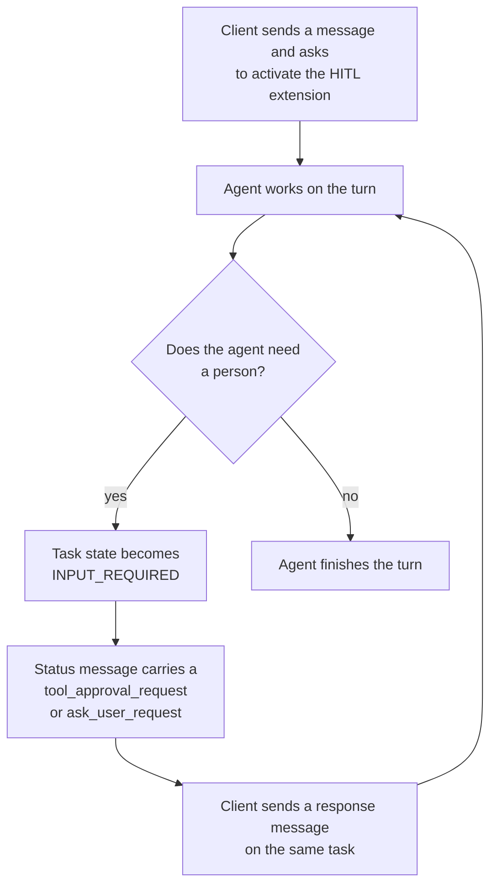

Some agents only answer questions, and those can run unattended. Others call tools that change a cluster, spend money, or read sensitive information. An agent that takes actions like those should get a person's approval first. The human in the loop (HITL) mechanism lets an agent stop mid-turn, return a question or a pending tool call to a person, and continue once that person answers.

A working HITL setup needs two halves. The agent must pause, which you configure by setting `requireApproval` on a tool binding in an AgentTemplate. The client must support the A2A human-in-the-loop extension, which presents the request to a person and returns the decision to the agent. A client without the extension still sees the agent stop, and cannot answer. Confirm that the client you plan to use supports the extension before you configure an agent to pause. For which clients qualify, see [Client support](#client-support).

## How a pause works

A client opens every turn by telling the agent which optional A2A extensions it can handle. A client that requests the HITL extension on that message can answer a pause later in the turn. kagent activates the extension only for the calls that request it, and attaches the pause payload only to those calls. A client that does not request the extension still receives a reply when the turn finishes. When the agent stops for a person, that client has no payload to answer.

The following diagram traces one turn in which the agent stops.



The agent works until it either finishes the turn or needs a person. When it needs a person, the task moves to `INPUT_REQUIRED` and its status message carries either a `tool_approval_request` or an `ask_user_request`. The client answers by sending a response message on the same task, and the agent resumes the turn where it left off.

## Pause kinds

An agent pauses either to get permission before it acts or to ask a question. A tool approval and a question raise different requests, but both pause and resume the same way. A client that handles one handles the other with a different payload.

| Request | Raised when | The client answers with |
| ------- | ----------- | ----------------------- |
| `tool_approval_request` | The agent wants to call a tool from a binding that sets `requireApproval`. | `tool_approval_response` |
| `ask_user_request` | The agent calls the built-in `ask_user` tool because it needs information only a person has. | `ask_user_response` |

Every pause also adds a plain text part to its status message that states why the agent stopped. A client that never activated the extension receives that text and nothing else. It can show a person why the agent stopped, but it has no `id` to answer with, so the task stays at `INPUT_REQUIRED`. Treat the text as a diagnostic rather than as a fallback, and send the turn again from a client that requests the extension. The `hint` field of an activated payload holds the same string.

The `kagent` harness composes this text from the pending calls. The wording depends on what the agent stopped for.

| Pause | Text |
| ----- | ---- |
| `ask_user` | The questions the agent asked, joined with `; `. |
| A tool pause whose tools supplied hints | The hints, followed by the tool names in parentheses, such as `Deleting this file requires approval (delete_file, restart_pod)`. |
| A tool pause with no hints | `Approval is required for tool(s): delete_file` |
| A pause carrying no tool call | `Human input is required before the agent can continue.` |

The `codex` and `claude` harnesses compose the text differently. Both pass through the hint that Codex or Claude Code supplied with the request, so the wording comes from the coding agent rather than from kagent.

## Require approval for a tool

Approval is a property of a tool binding. For example, if you set `requireApproval` on an `mcp` tool binding in the AgentTemplate, the agent stops before each call to a tool that the binding exposes.

### Harness support

The Harness that runs an agent decides which pauses the agent can raise, and how precisely a binding can express approval.

| Harness | Tool approval | `ask_user` question | Splitting one server across two bindings |
| ------- | ------------- | ------------------- | ---------------------------------------- |
| `kagent` | Supported | Supported | Supported |
| `codex` | Supported | Supported | Rejected, with `RemoteMCPServer "<name>" is bound more than once`. |
| `claude` | Supported | Unsupported, because the upstream Claude Code tool that backed it was removed. A `claude` agent pauses for tool approval only. | Rejected, with `RemoteMCPServer "<name>" is bound more than once`. A binding whose tool selection kagent cannot verify against the server's discovered tools exposes the whole server and reports a warning. |
| `byo` | Decided by your image | Decided by your image | Not applicable |

kagent passes each binding's `requireApproval` setting to a `byo` image, and the image decides whether to honor it. The agent card for a `byo` Agent never declares the HITL extension, so a client cannot learn from the card that the agent pauses, even when the image implements the extension. For what else that card omits, see [Bring your own agent]().

### Configure a binding

In the following AgentTemplate, the binding sets `requireApproval`, so the agent stops before it calls either Kubernetes tool.

```yaml
apiVersion: api.kagent.dev/v1alpha3
kind: AgentTemplate
metadata:
  name: cluster-operator
  namespace: kagent
spec:
  tools:
    - mcp:
        server:
          kind: RemoteMCPServer
          name: kagent-tool-server
        tools:
          - k8s_delete_resource
          - k8s_patch_resource
        requireApproval: true
```

 For the rest of the binding's fields, see [About tools]().

| Field | Description |
| ----- | ----------- |
| `mcp.tools` | The names of the tools to bind. Omit the list, or leave it empty, to bind every tool that the server offers. |
| `mcp.requireApproval` | Pauses before each invocation of a tool that this binding exposes. The pause covers the tools in `mcp.tools`, or every tool on the server when `mcp.tools` is omitted or empty. Omit to run the bound tools without approval. |

Approval belongs to the binding rather than to the tool name, so one server can supply tools that require approval alongside tools that do not. Bind the tools that require approval in a binding that sets `requireApproval`, and bind the tools that do not in a second binding that omits it. The `codex` and `claude` harnesses reject a second binding to the same server. An agent on those harnesses applies one approval setting to every tool that the server offers.

> [!NOTE]
> kagent 0.x named the tools that needed approval in a `requireApproval` list on the `Agent` resource, which matched tool names across every server. In 1.x, approval is a property of one binding, so the same tool name can pause for one server and run freely for another.

A tool that no binding covers with `requireApproval` runs without a pause. That includes every built-in tool, such as file access, shell, and web search, and every MCP tool on a binding that omits the field. The sandbox contains those calls. For more information, see [Sandboxing]().

## Implement a client that supports human approval

HITL is an [A2A](https://a2a-protocol.org) message extension, identified by a versioned URI. The following sections follow a client through one pause, from the header that it sends to the response that it returns.

### Request the extension

A client requests the extension by setting the extension URI as the `A2A-Extensions` header on the call that sends a message.

```http
A2A-Extensions: https://kagent.dev/extensions/hitl/v1
```

kagent activates the extension only for calls that request it. It then echoes the activated URI back, and attaches a structured pause payload only to an activated call. An agent's card declares the extension, so a client can discover HITL support before it sends anything.

A gRPC call names the Agent in the standard A2A `tenant` field, as `<namespace>/<name>`, and requests the extension through a header. Port-forward the controller's gRPC port first, as in [Install kagent]().

```bash
grpcurl -plaintext \
  -H 'A2A-Extensions: https://kagent.dev/extensions/hitl/v1' \
  -d '{
    "tenant": "kagent/cluster-operator",
    "message": {
      "messageId": "msg-1",
      "role": "ROLE_USER",
      "parts": [{"text": "Delete the obsolete pod in the production namespace."}]
    }
  }' localhost:8083 lf.a2a.v1.A2AService/SendStreamingMessage
```

A message that omits both a `contextId` and a task ID starts a new Session. To continue an existing one, set the message's `contextId` to the Session ID. Over HTTP, the URL path `/agents/{namespace}/{name}` selects the Agent instead, and no tenant is needed. For both transports, see [Call an agent over A2A]().

> [!WARNING]
> A send that omits the header produces a pause that no one can answer. The turn still stops, and its status message states the question as prose, with no `metadata` and no correlation `id`. The client therefore has nothing to render and no `id` to answer with. Re-reading that task with the header does not recover the payload, because kagent never attached one. To prevent this, send the header on every call. Sending it on a read is harmless, and missing it on a send cannot be undone.

### Read the pause

When the agent pauses, the task moves to `INPUT_REQUIRED`. The payload arrives in the status message's `metadata`, keyed by the extension URI. The message's `extensions` array lists the same URI. Each payload carries a `type` field that names its shape. kagent stores an attached payload with the task. A later read returns it whether or not that read requests the extension.

Each type travels in one direction. An agent raises a request, and a client answers with the matching response.

| Type | Direction |
| ---- | --------- |
| `tool_approval_request` | Agent to client |
| `ask_user_request` | Agent to client |
| `tool_approval_response` | Client to agent |
| `ask_user_response` | Client to agent |

### Approve or reject a tool

A `tool_approval_request` lists the pending calls, each with an `id`, the tool `name`, and the `args` the agent chose. Present those to a person, then send one `tool_approval_response` that decides every call in the request.

```json
{
  "type": "tool_approval_response",
  "approvals": [
    { "id": "<tool-id>", "approved": true },
    { "id": "<other-tool-id>", "approved": false, "rejection_reason": "Deleting that namespace is out of scope." }
  ]
}
```

A rejection reason is optional and worth sending because the agent receives it and can adapt rather than fail.

### Answer a question

An `ask_user_request` carries an `id` and a list of `questions`. The response echoes the same `id` and answers the questions in order.

```json
{
  "type": "ask_user_response",
  "id": "<request-id>",
  "answers": [
    { "answer": ["us-east-1"] }
  ]
}
```

> [!WARNING]
> Put the extension URI in the response message's `extensions` array as well as in its `metadata`. The `kagent` harness ignores a `metadata` payload that the array does not declare, and delivers the message as ordinary text. The task resumes and the agent replies, so the mistake is silent. The `codex` and `claude` harnesses reject the message with `tool approval response must declare https://kagent.dev/extensions/hitl/v1`.

## Resume a paused task

A paused task waits for the client to send a message that carries the response payload, on the same task and context. kagent rejects a resume attempt on a task that is not waiting.

While the task waits, kagent pauses the Actor rather than suspending it. A pause keeps the running process in a full snapshot on node-local storage. A harness that holds a live process across the wait, such as `codex` or `claude`, therefore continues the same turn on resume. The Worker is released in the meantime, so a conversation that sits at `INPUT_REQUIRED` does not consume pool capacity. For more information on the suspend that a finished turn uses instead, see [Suspend and resume]().

Because the transcript only grows, the question and the answer both stay in the task history, so a later reader can see what was asked and what a person decided.

## Task states

An A2A task moves through several states over its life. The following states mean that the task has stopped and is waiting, rather than working.

| State | Meaning |
| ----- | ------- |
| `INPUT_REQUIRED` | The agent is waiting for a person. This is the state that a tool approval or a question produces. |
| `AUTH_REQUIRED` | The agent is waiting for credentials. kagent's own harnesses never set this state. The gateway accepts a resume from it, so a `byo` image that produces it works. |

## Agents bound as tools

An agent that a parent binds as a tool can raise a pause of its own. The request then includes a `nested` block naming the subagent, along with its task and context. A client can therefore tell the person which agent is actually asking rather than attributing the question to the parent.

## Client support

The AgentTemplate decides that a turn pauses, and the client that raised the turn decides whether a person can answer it. To add support to a client of your own, see [Implement a client that supports human approval](#implement-a-client-that-supports-human-approval).

| Client | HITL |
| ------ | ---- |
| Your own A2A client | Full. Request the extension URI and handle every payload type. |
| An MCP client that supports tasks | Supported. The `invoke_session` tool returns a task, and input requests surface as MCP elicitations. |
| The kagent CLI | Not supported, and a turn that pauses is stranded. `kagent agent invoke` does not request the extension, so an agent that needs a person parks the task at `INPUT_REQUIRED` with nothing to answer it by. The CLI reports `Input required to continue this Session.` and stops there. Send the turn again from a client that requests the extension. |

## Next steps


  ` title="About tools" subtitle="Bind the tools that an approval request would cover." >}}
  ` title="System prompts" subtitle="Tell an agent when to ask rather than act." >}}

