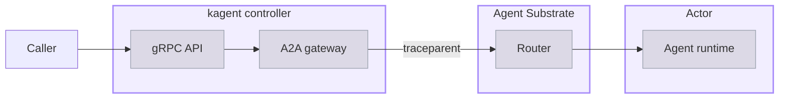

A trace records one agent request as a tree of timed spans, so you can see where a slow or failed request spent its time and which model and tool calls it made along the way. In  1.0 a single request crosses the controller, the Agent Substrate router, and the Actor that runs the agent, and one trace ties all three together.

## About trace coverage

A trace follows a W3C Trace Context header that the controller passes along with each request. The following diagram shows the path of one request, from the caller to the agent runtime.
</br></br>



A caller reaches the gRPC API on the kagent controller, which starts the trace. The controller hands the request to its A2A gateway, which opens an A2A (Agent2Agent) connection to the Session's Actor and injects a `traceparent` header into that call. The Agent Substrate router forwards the call to the Worker that runs the Actor, and adds its own spans to the trace. The agent runtime inside the Actor reads the header and continues the same trace, so the model and tool spans it produces hang off the controller's spans rather than starting a trace of their own.

Each hop sends its spans under a separate OpenTelemetry (OTel) service name. A tracing backend groups the spans by those names.

- **The controller** reports as `kagent-controller` in the `kagent` service namespace. Its spans also carry the pod, node, and namespace that the controller runs on.
- **The Agent Substrate router** runs the agentgateway proxy, and reports as `agentgateway`.
- **Each agent runtime** reports as its own service, named for the Agent it was compiled from. The `my-first-agent` Agent reports as `my-first-agent`. In kagent 0.x, every agent reported under a single `kagent` service. A backend that you filter by service now lists one entry for each Agent, so the list grows as you add Agents.

### Harness coverage

The controller passes its tracing configuration to every harness, and adds the collector to the Actor's egress allowlist. Which spans a harness then sends depends on its own instrumentation. For the available harnesses, see [Choose a harness](). For how the allowlist is built, see [Egress control]().

| Harness | What the trace shows |
| ------- | -------------------- |
| `kagent` | The runtime's spans. The span names on this page describe this runtime. |
| `codex` and `claude` | The request span, plus the `chat` spans for model calls and the `execute_tool` spans for tool calls that kagent writes. The native Claude Code or Codex process also emits its own spans. kagent marks that process with `kagent.genai.producer=runtime`, so that a collector can remove the duplicate GenAI model and usage attributes from the native spans. |
| `byo` | Spans only if the image implements OTel and reads the standard exporter variables. An image without OTel instrumentation leaves its half of the trace missing. A Harness `spec.env` entry overrides the controller's value for a variable of the same name, but an endpoint that you set this way is not added to the egress allowlist, so the image cannot reach it. |

### Spans

Each runtime creates spans for the request, the agent invocation, the model calls, and the tool calls. Most span names describe the operation rather than the agent. The `invoke_agent` span is the exception, because its name includes the name of the agent that ran. To narrow a search to one agent, filter by service name rather than by span name. The following table lists the spans in nesting order, starting with the span that accepts the request.

| Span | Runtime | When it is created |
| ---- | ------- | ------------------ |
| `lf.a2a.v1.A2AService/SendMessage` | `kagent`, `codex`, `claude` | Once per request, as the root of the runtime's half of the trace. The runtime creates it when it accepts the A2A call from the controller. The controller reports spans of the same name for its own side of the call. |
| `a2a.request` | `kagent` | Once per request. Records the A2A method and the final state of the task in the `a2a.method` and `a2a.task.state` attributes. |
| `invoke_agent <agent>` | `kagent`, `codex`, `claude` | Once per request, named for the Agent that serves it, with each hyphen replaced by an underscore. The Agent `my-first-agent` produces `invoke_agent my_first_agent`, while its service name keeps the hyphens, so the two spellings differ. On the `codex` and `claude` runtimes, this span is the request span, in place of `a2a.request`. |
| `generate_content <model>` | `kagent` | Once per model call, named for the model that was called. |
| `chat <model>` | `codex`, `claude` | Once per model call, named for the model that was called. One span covers a call and its automatic retries. For a retried call, the span includes `kagent.inference.retry.count`. For a call that ends without final usage, the span includes `kagent.inference.usage_partial=true`, so its output tokens are a lower bound. |
| `execute_tool <tool>` | `kagent`, `codex`, `claude` | Once per tool call, named for the tool that was called. On the `kagent` runtime, the span records the call's arguments and reply in the `gcp.vertex.agent.tool_call_args` and `gcp.vertex.agent.tool_response` attributes. On the `codex` and `claude` runtimes, content capture adds tool arguments and successful results in the `gen_ai.tool.call.arguments` and `gen_ai.tool.call.result` attributes. |
| `execute_tool (merged)` | `kagent` | Once per model turn that calls more than one tool, as the parent of that turn's `execute_tool` spans. A turn that calls a single tool does not create a merged span. |

### Correlation attributes

Use attributes, not span names, to identify a request in a trace. The runtime copies the request attributes to every descendant span. The runtime identity and main Agent identity are resource attributes, so use them to filter all spans from the same runtime process.

| Attribute | Where | Value |
| --------- | ----- | ----- |
| `a2a.task.id` | Span | The A2A task ID, which identifies one turn of a conversation. |
| `gen_ai.conversation.id` | Span | The A2A context ID, which identifies the conversation and is stable across its turns. |
| `gen_ai.agent.id` | Span | The Agent, as `<namespace>/<name>`. The shorter `gen_ai.agent.name` carries the name alone. |
| `enduser.id` | Span | The authenticated caller, such as `admin@kagent.dev`. |
| `gen_ai.main_agent.id` | Resource | The main Agent that the runtime process was compiled for, as `<namespace>/<name>`. This resource attribute replaces the resource-level `gen_ai.agent.id` name. |
| `kagent.runtime` | Resource | The runtime that served the request, such as `adk-go`. |
| `kagent.genai.producer` | Resource | `runtime` on a native `codex` or `claude` process. The value shows that kagent writes the GenAI model and tool spans for that process. A collector can use the value to avoid counting the native spans as duplicate model calls. |

The runtime also adds each scalar value in the A2A message's metadata as an `a2a.message.metadata.<key>` attribute, so a client can tag a request and search for it later. These tags stay on the `a2a.request` span alone, unlike the correlation attributes. A search on one therefore returns that span rather than the whole subtree.

> [!WARNING]
> When the `config.runtimeDefaults.telemetry.captureContent` Helm setting is `true`, prompts and replies reach your tracing backend. On the `kagent` runtime, the `generate_content` span of each model call then carries the conversation as the `gen_ai.input.messages` and `gen_ai.output.messages` attributes, and the Agent's system prompt as `gen_ai.system_instructions`. The setting defaults to `false`, which omits all three.
>
> On the `kagent` runtime, the setting does not govern tool content. An `execute_tool` span records the call's arguments and the tool's reply in `gcp.vertex.agent.tool_call_args` and `gcp.vertex.agent.tool_response` whether the setting is `true` or `false`. A tool that returns sensitive data sends it to your tracing backend on the default settings. On the `codex` and `claude` runtimes, content capture controls tool arguments and successful results. Turn tracing off for an agent whose tools return data that must not leave the cluster. For how to use this content as an audit record, see [Audit prompts]().

## Before you begin

1. [Install kagent]().
2. [Create your first agent](), so that you have an Agent to send a request to. That guide also installs the kagent CLI. The steps on this page need the  CLI, because the CLIs of other releases, newer ones included, do not have the Session commands that these steps use. To check your version, run `kagent version`.
3. Set up a tracing backend.

   The [OTel stack]() sends traces to Tempo, and the [Lightweight OTel stack]() sends traces to Jaeger. Both guides turn on tracing, so you can skip to [Review a trace](#review-a-trace).

## Enable tracing

Tracing is off by default. Turning it on is a Helm change, because the controller reads its tracing configuration from the environment and passes that configuration to the agent runtimes that the controller starts. The following steps send traces over OTLP to the collector that both stack guides install. To send traces to another OTLP backend, change the endpoint.

1. Save the current revision of your Agent. A later step uses it to tell when kagent recompiles the Agent with the new settings. The command first waits for any recompile that is still in progress, such as one from an earlier Helm upgrade, so that it saves a finished revision.
   ```bash
   for i in $(seq 1 60); do
     REVISIONS=$(kubectl get agent my-first-agent -n kagent \
       -o jsonpath='{.status.desiredRevision} {.status.latestSuccessfulRevision}')
     [ "${REVISIONS% *}" = "${REVISIONS#* }" ] && break
     sleep 5
   done
   export OLD_REVISION=${REVISIONS#* }
   echo "Current revision: $OLD_REVISION"
   ```

2. Get your current Helm values for kagent.
   ```shell
   helm get values kagent -n kagent -o yaml > values.yaml
   ```

3. Add the tracing settings to the values file.
   ```yaml
   config:
     telemetry:
       traces:
         endpoint: http://otel-collector.telemetry.svc.cluster.local:4317
         protocol: grpc
         timeout: 15s
     runtimeDefaults:
       telemetry:
         traces:
           endpoint: http://otel-collector.telemetry.svc.cluster.local:4317
           protocol: grpc
           timeout: 15s
   ```

   

   | Field | Description |
   | ----- | ----------- |
   | `config.telemetry.traces` | The traces of the kagent controller itself. |
   | `config.runtimeDefaults.telemetry.traces` | The traces of every agent runtime that the controller compiles. The controller's own settings do not propagate to a runtime, so set both blocks to trace the whole path of a request. |
   | `traces.endpoint` | Where the traces go, as an `http://` or `https://` URL. An `http://` endpoint sends plaintext. On the `http/protobuf` protocol, include the signal path, as in `http://otel-collector.telemetry.svc.cluster.local:4318/v1/traces`. |
   | `traces.protocol` | `grpc` or `http/protobuf`. Defaults to `grpc`, which matches the port `4317` in the example endpoint. Point `http/protobuf` at port `4318` instead. |
   | `traces.timeout` | The export timeout, as a duration in seconds with an `s` suffix. Defaults to `10s`. |

   A signal does not have a separate switch. When you set a signal's endpoint, the controller exports the signal. When you omit a signal's endpoint, the controller compiles an explicit off state for the signal. Omit the endpoint key rather than leaving it empty, because an empty endpoint fails validation. An endpoint must be an absolute `http://` or `https://` URL. The controller rejects one that includes credentials, a query, or a fragment. Check the controller's logs after you change these values.

4. Upgrade the kagent Helm release.
   ```bash
   helm upgrade kagent \
     / \
     --version  \
     --namespace kagent \
     --values values.yaml
   ```

5. Wait for kagent to recompile the Agent. The controller rebuilds each Agent after the controller restarts. A Session that you create before the rebuild finishes starts from the previous revision, without the new settings. The following command prints `Recompiled` when the new revision is ready.
   ```bash
   for i in $(seq 1 60); do
     [ "$(kubectl get agent my-first-agent -n kagent \
       -o jsonpath='{.status.latestSuccessfulRevision}')" != "$OLD_REVISION" ] \
       && echo "Recompiled" && break
     sleep 5
   done
   ```
   If the command finishes without printing `Recompiled`, the upgrade did not change the settings that kagent compiles into the Agent. Either the settings were already in place, or the chart did not recognize the `config` keys. Helm accepts a key that a chart does not define without an error, so check that you upgraded to version  of the chart, which uses the keys on this page.

6. Create a new Session, so that its Actor starts from a runtime that has the tracing configuration.
   ```bash
   kagent agent session create --agent my-first-agent
   ```

7. Confirm that the Session runs the Agent's current revision. The command waits until kagent finishes compiling the Agent, then compares that revision with the one that the Session started from. If the command prints `Outdated`, the Session was created from an earlier revision, and exports without the new settings. Create another Session, and run the command again.
   ```bash
   for i in $(seq 1 60); do
     REVISIONS=$(kubectl get agent my-first-agent -n kagent \
       -o jsonpath='{.status.desiredRevision} {.status.latestSuccessfulRevision}')
     [ "${REVISIONS% *}" = "${REVISIONS#* }" ] && break
     sleep 5
   done
   SESSION_REVISION=$(kagent agent session get $SESSION_ID -o json | jq -r '.session.preparedRevision')
   [ "$SESSION_REVISION" = "${REVISIONS#* }" ] && echo "Current" || echo "Outdated"
   ```

## Review a trace

Send a request to a new Session, then find its trace in the backend that you set up.

1. Send a request to a new Session to produce a trace.
   ```bash
   export SESSION_ID=$(kagent agent session create --agent my-first-agent -o json | jq -r '.session.id')
   kagent agent invoke --session $SESSION_ID --task "What is 2+2?"
   ```

2. Open the trace in your tracing backend.
   
   {}
   1. Forward the Grafana port, and leave the command running.
      ```bash
      kubectl port-forward -n telemetry svc/kube-prometheus-stack-grafana 3000:80
      ```
   2. In your browser, open Grafana at [http://localhost:3000](http://localhost:3000), and log in. For the password, see [Explore the telemetry in Grafana]().
   3. Open **Explore**, select the **Tempo** data source, and select the **Search** query type.
   4. From the **Service Name** list, select `my-first-agent`, and run the query. Selecting `kagent-controller` instead returns the same traces from the controller's side.
   5. Click a trace to open it.
   {}
   {}
   1. Forward the Jaeger query port, and leave the command running.
      ```bash
      kubectl port-forward -n telemetry svc/jaeger 16686:16686
      ```
   2. In your browser, open Jaeger at [http://localhost:16686](http://localhost:16686).
   3. From the **Service** list, select `my-first-agent`. Selecting `kagent-controller` instead returns the same traces from the controller's side.
   4. Leave **Operation** on `all`, or select `invoke_agent <agent>` to start from the agent's own work rather than from the A2A call that carries it, and click **Find Traces**.
   5. Click a trace to open it.
   {}
   

3. Review the span tree. The trace starts with the controller's spans, continues through the Agent Substrate router, and ends with the agent runtime's spans. The following example shows the spans of one request, with the service that reported each span.
   ```console
   lf.a2a.v1.A2AService/SendMessage                         kagent-controller
     lf.a2a.v1.A2AService/SendMessage                       kagent-controller
       POST /*                                              agentgateway
         POST                                               agentgateway
           lf.a2a.v1.A2AService/SendMessage                 my-first-agent
             a2a.request                                    my-first-agent
               invoke_agent my_first_agent                   my-first-agent
                 generate_content gpt-4.1-mini              my-first-agent
                   HTTP POST                                my-first-agent
   ```

4. Use a span attribute, such as `gen_ai.conversation.id=<context-id>`, to narrow a search to one conversation. Use a resource attribute, such as `gen_ai.main_agent.id=<namespace>/<agent>`, to narrow a search to one runtime process.

## Agent Substrate traces

Agent Substrate records traces for its own work, such as scheduling an Actor onto a Worker and restoring it from a snapshot. These traces are separate from the agent request trace, and do not share its ID. The router's `agentgateway` spans are the exception, and join the request trace. The `POST /*` span covers the whole request at the router, including any wait for the Actor to resume, but does not show which step of the resume took the time. To investigate a slow start, look up the Agent Substrate traces from the same time window, or read the Actor's [suspend and resume records](), which carry the trace ID of each operation.

| Service | Reports |
| ------- | ------- |
| `ateapi` | Actor lifecycle operations, such as create, resume, and suspend, and the scheduling of Actors onto Workers. |
| `atelet` | Work on a Worker's node, such as restoring an Actor from a snapshot. |
| `ateom-gvisor` | Work inside the sandbox that runs the Actor. |
| `atecontroller` | Reconciliation of Agent Substrate resources, such as WorkerPools. |

Agent Substrate exports traces only when its Helm release sets `otel.endpoint`, and it keeps 1% of its traces by default. To keep more, raise `otel.traces.samplingRatio`.

For the steps, see [Send Agent Substrate telemetry to the collector]().

## Traces from a suspended Actor

Agent Substrate checkpoints an Actor as soon as the response body closes, which is sooner than a batching span exporter normally sends its buffer. Spans still in the buffer at that moment freeze inside the snapshot and reach the backend only when the session next resumes, or never at all for a conversation's last message.

To avoid losing them, the `kagent`, `codex`, and `claude` runtimes flush their span buffer after each A2A handler returns, before the response completes. The flush is unconditional and waits up to three seconds, and no setting changes either. An agent on the `byo` harness flushes only if its own image does, so a conversation's last turn can lose its spans there.

The flush lets a kagent trace arrive promptly rather than on the exporter's own schedule. To understand what suspension does to an Actor, see [Suspend and resume]().

## Turn tracing off

Turn off the trace exporter, then create a new Session so that the change takes effect. The controller sets the trace exporter to `none` in each runtime, so an agent does not fall back to the OpenTelemetry SDK's default of exporting to `localhost`.

1. Remove the telemetry settings from the kagent Helm release. Remove the whole `telemetry` block rather than one signal inside it. The controller rejects a null value anywhere in its configuration and fails to start, so a values file that sets a single signal to `null` breaks the installation. A `--set` flag removes the key instead of nulling it.
   ```bash
   helm upgrade kagent \
     / \
     --version  \
     --namespace kagent --reuse-values \
     --set config.telemetry=null \
     --set config.runtimeDefaults.telemetry=null
   ```

2. Create a new Session to pick up the change, because an existing Actor keeps the configuration it started with.

3. To remove the tracing backend, follow the cleanup steps in the [OTel stack]() or [Lightweight OTel stack]() guide.

## Next steps


  ` title="Audit prompts" subtitle="Export every prompt and reply as a log event for security and compliance review." >}}
  ` title="Metrics" subtitle="Review the metrics that kagent and Agent Substrate report." >}}
  ` title="Suspend and resume" subtitle="Learn what happens to an Actor between the turns of a conversation." >}}

