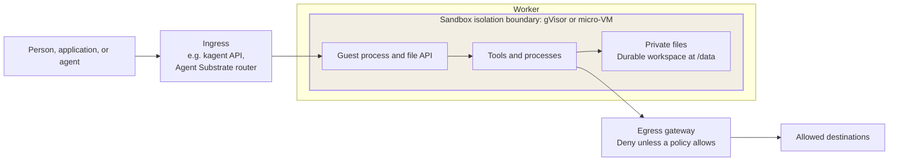

A kagent Sandbox is an isolated scratch environment for running commands and working with files. You create a Sandbox from a SandboxTemplate, run processes and move files in it, then delete it or let it expire. The Sandbox belongs to the caller that created it, and other identities cannot see it.

A Sandbox has no harness, no model, and no conversation. It runs whatever its caller tells it to run. That caller can be a person at a terminal, an application, or an agent that wants a safe place to run the code that it wrote.

The isolation boundary separates the Sandbox's files, tools, and processes from the host and other runtimes. kagent controls network access in both directions. Inbound traffic reaches the Sandbox only through the controller and the Agent Substrate router. Outbound traffic requires an EgressPolicy that allows the destination.

Agent Substrate manages the ingress path. Creating a Sandbox does not expose a public endpoint for programs inside it. You grant outbound access through the SandboxTemplate's egress policy references. For the routing and policy details, see [Sandboxing]().

## Sandboxes and sandbox isolation

The word _sandbox_ names two related things in kagent.

* **The isolation boundary.** [Agent Substrate]() runs every Actor inside a sandbox, by default a [gVisor](https://gvisor.dev) user-space kernel. A WorkerPool selects the sandbox class, and a cluster-scoped Agent Substrate `SandboxConfig` resource (`ate.dev/v1`) describes the runtime files for that class. Every agent Session and every standalone Sandbox runs behind this boundary. You configure it once per WorkerPool, and you do not interact with it directly. For more information, see [Sandboxing]().
* **The Sandbox runtime.** A kagent Sandbox is a runtime that a caller creates, uses, and deletes through the kagent API. It runs on an Actor, so it sits behind the same isolation boundary. You configure it with a SandboxTemplate (`api.kagent.dev/v1alpha3`), and you work with it through the CLI, the kagent Model Context Protocol (MCP) server, or gRPC.

The pages in this section cover the Sandbox runtime. To change the isolation technology itself, such as moving a pool from gVisor to micro-VMs, see [Sandboxing]().

For a broader comparison of sandbox designs, read Christian Posta's [Not All Agent Sandboxes Are Created Equally](https://kagent.dev/blog/agent-sandboxes-four-axes). The blog introduces four axes for evaluating a sandbox: boundary and access controls, environment, lifecycle, and interface and experience.

## Where the agent loop runs

An agent runs a loop. A model proposes a step, a tool or a command carries it out, and the result feeds the model's next decision. Where that loop runs decides which kagent feature you use.

| Where the loop runs | What runs in the isolated environment | What you use |
| ------------------- | ------------------------------------- | ------------ |
| In your cluster, as a kagent agent | The whole agent: the harness, its tools, and its working files | An Agent, which runs each conversation as a Session. For more information, see [Agents](). |
{}| In your cluster, as a kagent agent that needs a separate place to run code | Only the code that the agent hands off, apart from the agent's own Session | An Agent with the sandbox tools from the kagent MCP server. For more information, see [Give an agent a sandbox](). |
{}| Outside the cluster, in an MCP client such as Claude Code or Cursor | Only the code or commands that the client sends | The sandbox tools and prompts of the kagent MCP server. For more information, see [Use sandboxes from an MCP client](). |
| In your own application | Only the code or commands that the application sends | The `SandboxService` gRPC API. For more information, see [Use sandboxes with the gRPC API](). |
| Nowhere, because a person runs the commands | Commands and files from a terminal | The `kagent sandbox` CLI. For more information, see [Run commands with the CLI](). |

When the whole agent runs in the isolated environment, its Session holds the conversation, and the Actor holds the agent's files. When the loop runs elsewhere, the conversation is already safe with the caller, so a Sandbox is usually short-lived. The caller creates it for a task, collects the results, and deletes it.


  


## Sandboxes and Sessions

A Sandbox and a Session are separate runtimes with separate configuration and separate lifetimes. Neither resource references the other.

| What you configure | What runs | What you call it with |
| ------------------ | --------- | --------------------- |
| An Agent that pairs an AgentTemplate with a Harness | A Session | A2A interactions and tasks |
| A SandboxTemplate that defines a tools environment | A Sandbox | Guest process and file operations |

{}An agent that creates a Sandbox through the MCP server uses the same service that a person calls. The Sandbox does not end when the agent's Session ends, and it does not share the Session's files.{}

## How a Sandbox is built

A SandboxTemplate names a tools image, pinned by digest, and the WorkerPool that runs it. When you apply a template, kagent prepares a reusable revision of it. The revision combines the template with the installation's guest image, CPU, and memory settings. kagent then has Agent Substrate build a golden snapshot of that revision. The template reports `Ready` only after the snapshot exists. Applying a template does not allocate a Sandbox.

Each Sandbox pins the revision that it was created from. Editing the template prepares a new revision for new Sandboxes, while existing Sandboxes keep their own. Deleting the template stops new Sandboxes from being created but does not remove the Sandboxes that already exist.

kagent runs its own guest program in every Sandbox, which serves the process and file operations. The guest replaces the tools image's entrypoint, so the tools image supplies only the installed programs. For setup steps, see [Set up sandbox templates]().

## Lifecycle

A caller can create, get, list, suspend, resume, and delete a Sandbox. Each Sandbox reports two fields, and a caller checks both, because lifecycle work can still be pending when a call returns.

| Field | Values | What it tells you |
| ----- | ------ | ----------------- |
| `state` | `RUNTIME_STATE_CREATING`, `RUNTIME_STATE_READY`, `RUNTIME_STATE_SUSPENDED`, `RUNTIME_STATE_FAILED`, `RUNTIME_STATE_DELETING`, `RUNTIME_STATE_DELETED` | Where the Sandbox is now. Process and file operations need `RUNTIME_STATE_READY`. |
| `operation` | `RUNTIME_OPERATION_NONE`, `RUNTIME_OPERATION_CREATE`, `RUNTIME_OPERATION_SUSPEND`, `RUNTIME_OPERATION_RESUME`, `RUNTIME_OPERATION_DELETE` | Which lifecycle change is still in progress. `RUNTIME_OPERATION_NONE` means that nothing is pending. |

Each lifecycle call makes one attempt and returns. If an attempt fails with a temporary error, the change stays pending. To continue it, repeat the same call. Reading a Sandbox never advances pending work.

Every create request carries a request ID. If you retry with the same request ID and the same input, you get the same Sandbox back. A new request ID creates a new Sandbox, so keep the ID until the create call succeeds.

### Expiration

Every Sandbox expires at a fixed time, which the `expires_at` field reports. The caller can request a lifetime when it creates the Sandbox. Otherwise, the installation's default applies, which is one hour unless an operator changes it. Activity does not extend the lifetime, and neither does a resume. When a Sandbox expires, kagent rejects new process and file operations and deletes it, even if it is suspended. To keep a result, copy it out of the Sandbox before it expires.

## Files and processes across suspension

Suspending a Sandbox saves its durable files to a snapshot and releases the compute that it held. Resuming it starts a fresh guest on whichever Worker has room, with the saved files restored.

| What | Survives suspend and resume? |
| ---- | ---------------------------- |
| Files under `/data`, including the default working directory, `/data/workspace` | Yes |
| Files anywhere else in the filesystem | No. A resumed Sandbox starts from the image again. |
| Running processes and their process IDs | No. Suspension stops them, and resume does not restart them. |

Suspension does not wait for a process, an output stream, or a file transfer to finish. A command can be cut off partway through, and a file can be left partly written. Suspend a Sandbox only when you can repeat what it was running. For more information about snapshots, see [Suspend and resume]().

## Network access

A Sandbox cannot open any outbound connection by default. A command that installs a package, clones a repository, or calls an API fails until the SandboxTemplate selects an EgressPolicy that allows the destination. An EgressPolicy can also inject a credential into the Sandbox's outbound requests, so the credential never enters the Sandbox. For more information, see [Egress policies]().

## Ownership and access

A Sandbox belongs to the identity that created it. A list returns only the caller's own Sandboxes, and a request for another identity's Sandbox returns a not-found error.

* **People and applications**: The owner is the identity that the kagent API resolved for the call.{} In the default `insecure` authentication mode, a caller names its own identity, so this ownership keeps one caller's Sandboxes out of another caller's list but is not a security boundary. For the authentication modes, see [Controller authentication modes]().{}
{}* **Agents**: An agent owns the Sandboxes that it creates under the identity that its MCP connection authenticated, not the identity of the person that the agent is talking to. For details, see [Who owns an agent's Sandboxes]().
{}* **Session share tokens**: A share token for a Session does not grant access to any Sandbox.

## Interfaces and limits

Every interface reaches the same service, so a Sandbox that you create with one interface is visible from the others under the same identity.

| Interface | Best for | File transfer limit |
| --------- | -------- | ------------------- |
| The `kagent sandbox` CLI | People, scripts, and continuous integration jobs | 64 MiB per file, streamed |
| The kagent MCP server's sandbox tools | {}Agents and {}MCP clients | 1 MiB per write or output read, base64-encoded |
| The `kagent.api.v1.SandboxService` gRPC API, with the Agent Substrate process and file services | Applications | 64 MiB per file, streamed |

The installation sets the CPU, memory, default lifetime, and maximum lifetime for every Sandbox. A SandboxTemplate cannot override them. The defaults are one CPU, 1 GiB of memory, a one-hour lifetime, and a 24-hour maximum.
