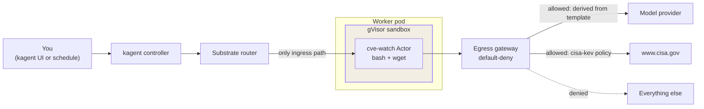

export const metadata = {
  title: "Build a CVE Agent with kagent and Agent Substrate in a Secure Sandbox",
  publishDate: "2026-11-24T12:00:00Z",
  description:
    "An agent that tracks vulnerabilities has to read the internet, which makes it the agent you least want running loose in your cluster. Build cve-watch the safe way: one egress policy for www.cisa.gov, one agent, and one schedule, running in a gVisor sandbox with default-deny egress on Agent Substrate.",
  author: "Sebastian Maniak",
  authorIds: ["sebastianmaniak"],
};

# Build a CVE Agent with kagent and Agent Substrate in a Secure Sandbox

An agent that tracks vulnerabilities has to read the internet, and an agent that reads the internet is the one you least want running loose in your cluster. This post builds a small one the safe way: `cve-watch`, an agent that fetches the [CISA Known Exploited Vulnerabilities (KEV) catalog](https://www.cisa.gov/known-exploited-vulnerabilities-catalog) and tells you what was added.

It runs on kagent 1.0, where every agent runs on Agent Substrate. That gives you two things without any extra work:

- **Each conversation runs in its own gVisor sandbox**, not in a shared, long-running pod.
- **The sandbox has default-deny egress.** The agent can reach its model, and nothing else, until you grant a destination.

So the whole build is three objects: one egress policy for `www.cisa.gov`, one agent, and one schedule. There is no MCP server to write. Along the way, I cover the sandbox background and a test that shows the policy doing its job.


## What you build

| Piece | What it is |
| --- | --- |
| `cisa-kev` | An `EgressPolicy` that grants one origin, `https://www.cisa.gov` |
| `cve-watch` | An `Agent` on the `kagent-default` harness, with a system prompt that tells it exactly how to fetch the catalog |
| `kev-daily` | A schedule that asks the agent for the last seven days of additions, every day |

The agent's only tool is the bash tool that every agent on the kagent harness has. The runtime image includes `wget`, and that's enough to read a public JSON feed.

## Why the sandbox matters for this agent

A CVE agent pulls in text that somebody else wrote and hands it to a model that can run shell commands. That is the standard recipe for prompt injection, so the useful question is what the session can touch if it goes wrong. On Agent Substrate the answer is short.



kagent runs the agent's loop inside an **Actor**, and each Actor has its own sandbox. The sandbox separates the Actor from the node in three places:

- **Process and kernel.** The agent's system calls go to [gVisor](https://gvisor.dev)'s user-space kernel, not to the host kernel. (Substrate also has a `microvm` class if you want a hypervisor boundary.)
- **Filesystem.** The Actor sees the filesystem from its image, plus any volume its template declares. It doesn't see the Worker's.
- **Network.** The Actor gets a private, point-to-point network inside the Worker pod. Inbound, a NetworkPolicy lets only the Substrate router connect to a Worker. Outbound, every connection goes through the egress gateway.

The egress gateway is the part this post leans on. It identifies the Actor from its certificate (a SPIFFE ID), looks up the policy for that Actor, and denies any connection that no rule allows. It terminates TLS, so a hostname rule applies to HTTPS traffic too. The agent can't get around it by setting a different `Host` header, because the gateway trusts the certificate and not the request.

kagent writes most of that policy for you. It reads the agent's template and allows what the template already names, such as the model provider and any MCP servers. Anything else needs an `EgressPolicy` that you create and select on the agent. For `cve-watch`, that's `www.cisa.gov`.

If you want the longer argument for per-session sandboxes, see [Kagent and Agent Substrate: Running AI Agent Sandboxes on Kubernetes](/blog/kagent-agent-substrate-sandboxes) and [comparing agent sandboxes](/blog/agent-sandboxes-four-axes).

## Before you begin

You need a Kubernetes cluster at **1.37 or later**, plus `kubectl` and `helm` 3. Agent Substrate depends on the `PodCertificateRequest` and `ClusterTrustBundle` APIs, which are GA in 1.37. A local [kind](https://kind.sigs.k8s.io/) cluster works, with kind v0.32.0 or later:

```bash
kind create cluster --name kagent --image kindest/node:v1.37.0
```

Set your model provider's API key, then install the CLI and kagent. This installs the CRDs, Agent Substrate, a development PostgreSQL database and kagent, and it takes a few minutes.

```bash
export OPENAI_API_KEY="your-api-key-here"
curl -sL https://kagent.dev/install | bash && kagent install
```

`kagent install` uses OpenAI by default. For another provider, set that provider's key and pass `--provider`, for example `kagent install --provider Anthropic`.

Check that the worker pool is ready. This is the pool of gVisor Workers that your agent's sandbox runs on.

```bash
kubectl get workerpools -n kagent
```

Example output for a fresh install:

```console
NAME             DESIRED   REPLICAS   READY   SANDBOXCONFIG    RESOLVED   AGE
kagent-default   1         1          1       gvisor-default   True       2m
```

Then open the UI:

```bash
kagent dashboard
```

## Step 1: Allow the agent to reach CISA

Start with the policy, because the agent form asks you to pick it.

1. In the sidebar, click **Policies**, and then click **Create egress policy**.
2. In the **Name** field, enter `cisa-kev`. Leave the **Namespace** as `kagent`.
3. Under **Destination 1**, in the **Origin** field, enter `https://www.cisa.gov`.
4. Leave **Authentication** set to **None**. The catalog is public.
5. Click **Create policy**.

Two things to know about origins:

- **An origin has no path.** You grant the scheme, host and port, and the grant covers every path on that host. You can't limit the agent to the one feed URL, so the policy is "all of `www.cisa.gov`".
- **Redirects need their own grant.** If a destination redirects to another host, that host has to be in a policy too. The KEV feed is served from `www.cisa.gov` directly, so one origin is enough here.

## Step 2: Create the agent

1. In the sidebar, click **Agents**, and then click **New Agent**.

2. In the **Name** field, enter `cve-watch`. Leave the **Namespace** as `kagent`, and leave **Shared harness** set to `kagent-default`.

3. In the **Template** section, select **Inline**, and fill it in.

   | Field | Value |
   | --- | --- |
   | **Model configuration** | `kagent/default-model-config` |
   | **Description** | `Reports the newest known exploited vulnerabilities from CISA` |

4. In the **System prompt** field, enter this prompt.

   ```text
   You track the CISA Known Exploited Vulnerabilities (KEV) catalog.
   To read the newest entries, run this command with the bash tool:
   wget -qO- https://www.cisa.gov/sites/default/files/feeds/known_exploited_vulnerabilities.json | head -n 400
   The catalog lists the newest entries first. Never answer from memory. Always fetch the catalog first.
   For each vulnerability, report the CVE ID, the vendor and product, the date added, the due date, and whether it is used in ransomware campaigns.
   If the command fails, say so and show the error.
   ```

5. From the **Egress policies** list at the end of the form, choose `cisa-kev`.

6. Click **Create agent**, and then click **Refresh** until the agent is **Ready**.

The prompt gives the agent the exact command, and that's deliberate:

- **`head -n 400` keeps the output small.** The catalog is a large JSON file with the newest entries at the top. Cutting it keeps the result within what the bash tool returns.
- **"Always fetch" stops stale answers.** A model's memory of "recent CVEs" is out of date by definition. Telling it to fetch first means the answer comes from the feed.
- **`wget`, not `curl`.** The kagent runtime image has `wget` and no `curl`. If you don't say so, the agent spends a few tool calls finding out.
- **"Say so and show the error."** If egress is blocked, you want the agent to report the failure, not invent a list of CVEs.

## Step 3: Ask what is new

Click the agent name, `cve-watch`, to open its chat page, and ask:

```text
What did CISA add to the catalog this week?
```

The conversation shows the bash tool call that fetches the catalog, and then the agent's summary of the newest entries: CVE ID, vendor and product, date added, due date and the ransomware flag.

## Step 4: Prove the sandbox says no

The demo so far shows what the agent can reach. Check what it can't reach before you trust it.

First, confirm that kagent accepted the policy:

```bash
kubectl get agent cve-watch -n kagent \
  -o jsonpath='{range .status.conditions[?(@.type=="EgressPoliciesApplied")]}{.status} {.reason} {.message}{end}'
```

You want `True Applied`. This condition is separate from `Ready`. An agent whose policy is missing or invalid still reports `Ready` and still serves sessions, just without the grant, so `Ready` alone doesn't tell you the policy is attached.

Then ask the agent to open a connection to a host you didn't grant. The process exits with code `0` either way, so the command prints a word for you to read:

```bash
export SESSION_ID=$(kagent agent session create --agent cve-watch -o json | jq -r '.session.id')
kagent agent invoke --session $SESSION_ID \
  --task "Use your bash tool to run exactly this command, then reply with only its output: bash -c 'exec 3<>/dev/tcp/registry.npmjs.org/443 && echo reachable || echo blocked'"
```

The expected answer is `blocked`. A destination that no grant allows doesn't resolve, so the connection fails before it leaves the cluster. Run the same check against `www.cisa.gov` and it should print `reachable`.

You can also test the other direction. Edit the agent, clear `cisa-kev` from **Egress policies**, and ask the question from step 3 again. The `wget` fails, and because of the last line of the prompt, the agent tells you so. Put the policy back when you're done.

## Step 5: Get a daily report

To have the agent report without being asked, put it on a schedule.

1. In the sidebar, click **Schedules**, and then click **New Schedule**.
2. From the **Agent** list, choose `kagent/cve-watch`, and name the schedule `kev-daily`.
3. Leave **Repeat** set to **Daily**. Set the time zone and time if you don't want the defaults.
4. In the **Prompt** field, enter `List the vulnerabilities that CISA added in the last seven days.`
5. Click **Create schedule**.

Each run starts a new conversation, and you open it from the schedule's **Execution history**. The **Run** button at the top of the schedule page starts a run now, which is the quick way to test it.


This recording uses a different agent (`personal-assistant`, schedule `morning-brief`, from the [personal AI assistant tutorial](/blog/personal-ai-assistant-kagent-agent-substrate)), but the steps are the same for `cve-watch`.

A daily report is also where Substrate's other half pays off. Between runs, the agent's Actor is suspended and holds no Worker, so a once-a-day CVE check costs a few seconds of compute a day, not a pod around the clock.

## The YAML version

Everything you did in the UI, apart from the schedule, is stored as Kubernetes resources, so you can keep it in Git. Here are the same two objects.

The `cisa-kev` egress policy:

```bash
kubectl apply -f - <<EOF
apiVersion: api.kagent.dev/v1alpha3
kind: EgressPolicy
metadata:
  name: cisa-kev
  namespace: kagent
spec:
  destinations:
    - origin: https://www.cisa.gov
EOF
```

The `cve-watch` agent, with the policy attached:

```bash
kubectl apply -f - <<EOF
apiVersion: api.kagent.dev/v1alpha3
kind: Agent
metadata:
  name: cve-watch
  namespace: kagent
spec:
  harnessRef:
    name: kagent-default
  egressPolicyRefs:
    - name: cisa-kev
  template:
    inline:
      description: Reports the newest known exploited vulnerabilities from CISA
      modelConfig:
        name: default-model-config
      systemPrompt: |-
        You track the CISA Known Exploited Vulnerabilities (KEV) catalog.
        To read the newest entries, run this command with the bash tool:
        wget -qO- https://www.cisa.gov/sites/default/files/feeds/known_exploited_vulnerabilities.json | head -n 400
        The catalog lists the newest entries first. Never answer from memory. Always fetch the catalog first.
        For each vulnerability, report the CVE ID, the vendor and product, the date added, the due date, and whether it is used in ransomware campaigns.
        If the command fails, say so and show the error.
EOF
```

The schedule is the exception. A schedule is not a Kubernetes resource, so it has no YAML and GitOps won't restore it. To create one without the UI, use kagent's `ScheduledRunService` gRPC API.

## Things to know

- **The policy is selected on the Agent**, not the template or harness. Two agents that share a template can have different network access.
- **A policy only works in its own namespace.** `cve-watch` is in `kagent`, so `cisa-kev` has to be there too.
- **The grant is the whole host.** The agent can fetch any page on `www.cisa.gov`. For a public government site that's fine. For an API with write endpoints, think about it.
- **TCP only.** Substrate blocks UDP, and the gateway needs the client to send first, so protocols like SSH and SMTP don't pass.
- **Limits.** An agent can select 16 policies, a policy can list 64 destinations, and the compiled policy for one Actor holds 256 rules.

## Clean up

```bash
kubectl delete agent cve-watch -n kagent
kubectl delete egresspolicy cisa-kev -n kagent
```

Delete the `kev-daily` schedule from the **Schedules** page.

## Wrap-up

`cve-watch` is about as small as a useful agent gets: one prompt, one built-in tool, one allowed host. What makes it safe to run is the platform under it. The session is a gVisor sandbox, the network is closed until you open it, and the opening is one line of YAML that you can read in a pull request.

From here, the same pattern scales up. Add an origin for another feed such as OSV.dev or a vendor advisory site, attach an MCP server for your ticketing system, or give the gateway a credential to inject so the agent never holds the token.

Related reading:

- [Build a Personal AI Assistant with kagent and Agent Substrate](/blog/personal-ai-assistant-kagent-agent-substrate): the same build steps, with Agent Substrate as the engine underneath.
- [kagent 1.0 Is Here: Open Source Agents on Agent Substrate](/blog/kagent-v1-0-release): why every kagent agent now runs in a sandbox.
- [Kagent and Agent Substrate: Running AI Agent Sandboxes on Kubernetes](/blog/kagent-agent-substrate-sandboxes): gVisor and microVM sandboxes in more depth.
- [Code Share: Deploy kagent with Agent Substrate](/blog/deploy-kagent-with-agent-substrate): kagent OSS and Agent Substrate on kind.
