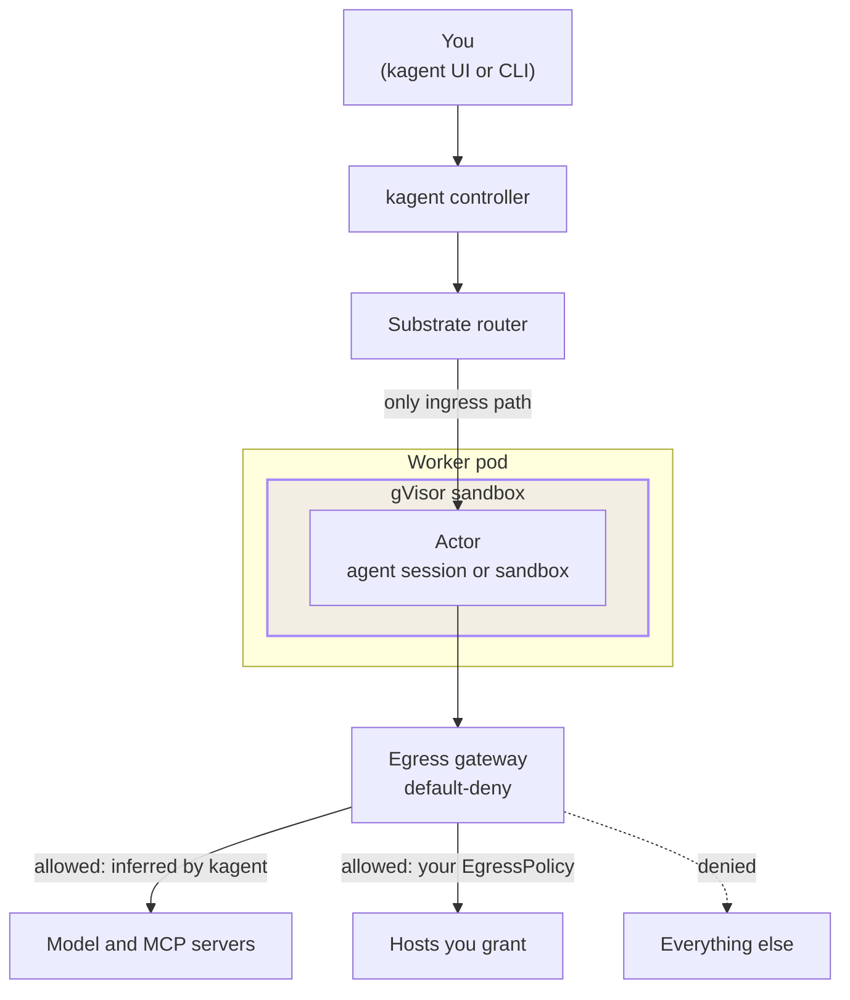

export const metadata = {
  title: "kagent Has a Policies Page Now: A Walkthrough of Egress Policies in the Open Source UI",
  publishDate: "2026-11-24T12:00:00Z",
  description:
    "The open source kagent UI has a Policies page. It manages EgressPolicy, the allow-list that decides which HTTP(S) hosts a sandboxed agent can reach on Agent Substrate. This walkthrough covers every screen: the list, the create form and its three authentication modes, the detail view, attaching a policy to an agent, and deleting one. It also includes a live test from inside a sandbox that shows a host blocked, then allowed, then blocked again, with no restart.",
  author: "Sebastian Maniak",
  authorIds: ["sebastianmaniak"],
};

# kagent Has a Policies Page Now: A Walkthrough of Egress Policies in the Open Source UI

The open source kagent UI has a **Policies** page. You no longer need to write YAML to decide which hosts your agents can reach: you can create, attach, inspect and delete egress policies from the browser.

This post walks through every screen on kagent 1.0.1, running on a local kind cluster. At the end, I test a policy from inside a running sandbox to show that it does what the UI says.


## What a policy is

In kagent 1.0, every agent conversation and every standalone sandbox runs on Agent Substrate with **default-deny egress**. The workload can reach what kagent infers it needs, such as its model and its MCP servers, and nothing else.

An **egress policy** is how you add to that list. Each policy does two things:

- It lists extra HTTP(S) origins that a workload may reach.
- Optionally, it tells the egress gateway to add a credential to requests for an origin. The agent never sees the credential.

Behind the page is one resource, `EgressPolicy`, in the `api.kagent.dev/v1alpha3` API group. It's namespaced. An agent or a sandbox template selects policies by name, from its own namespace.

Three things to know before you start:

- **Egress is the only policy type today.** The page has one tab, **Egress Policies**. It doesn't manage tool, model or agent-to-agent access.
- **A policy only adds access.** It can't remove a destination that kagent inferred from the agent's model and tools.
- **Model and MCP server hosts don't need a policy.** The page says so itself.

## Where policies sit: the sandbox and Agent Substrate

A policy only makes sense once you know what it's a hole in. So here's the short version of how kagent 1.0 runs an agent.

kagent doesn't run your agent as an ordinary pod. It runs it on **Agent Substrate**, the runtime that `kagent install` puts in the `ate-system` namespace. Substrate has a few terms worth knowing:

| Term | What it is |
|----|----|
| Worker pool | A set of Worker pods that are ready to run sandboxes. A fresh install has one, `kagent-default` |
| Actor | One running agent session or one standalone sandbox. Each Actor gets its own sandbox |
| Actor template | The prepared image and snapshot that new Actors start from. kagent makes one for each agent and each sandbox template |
| Egress gateway | The `atenet-egress` deployment. Every outbound connection from an Actor goes through it |
| Router | The `atenet-router` deployment. It's the only way in to an Actor |



The sandbox separates an Actor from the node in three places:

- **Process and kernel.** The agent's system calls go to gVisor's user-space kernel, not to the host kernel.
- **Filesystem.** The Actor sees the filesystem from its image, plus any volume its template declares. It doesn't see the Worker's.
- **Network.** Inbound, only the Substrate router can connect. Outbound, every connection goes through the egress gateway, and the gateway denies anything that no rule allows.

You can check the sandbox class on your own cluster. The `SANDBOXCONFIG` column shows which one the pool uses:

```bash
kubectl get workerpools -n kagent
```

```console
NAME             DESIRED   REPLICAS   READY   SANDBOXCONFIG    RESOLVED   AGE
kagent-default   1         1          1       gvisor-default   True       27h
```

The first two boundaries need no input from you. The network one does, because only you know which hosts an agent has a reason to call. kagent fills in the obvious part: it reads the agent's template and allows the model provider and the MCP servers that the template names. **Everything else is yours to grant, and the Policies page is where you grant it.**

That's why this page matters more than a settings screen usually does. An agent reads text that somebody else wrote and can act on it. If a prompt injection gets through, the allow-list is what limits where the agent can send your data. I go deeper on the sandbox itself in [Build a CVE agent with kagent and Agent Substrate in a secure sandbox](/blog/kagent-cve-agent-substrate-secure-sandbox).

## Before you begin

You need kagent 1.0 or later with the UI open. If you don't have that yet, [install kagent locally with one command](https://maniak.io/articles/2026-11-24-install-kagent-locally-kind-one-command/) and then run:

```bash
kagent dashboard
```

The UI opens at `http://localhost:8082`.

## The Policies page

Click **Policies** in the sidebar.


The page has two parts.

**The overview** is a diagram of the model: an Agent or a SandboxTemplate lists the policies it needs, the EgressPolicy holds the origins and any credential, and the result is the set of HTTP(S) hosts the workload can now reach.

**The table** lists every policy you can see:

| Column         | What it shows                                           |
|----------------|---------------------------------------------------------|
| Name           | The policy name. Click it to open the detail view       |
| Namespace      | Where the policy lives                                  |
| Origins        | How many destinations the policy allows                 |
| Authentication | `None`, `Secret key` or `Actor JWT`                     |
| Used by        | How many agents and sandbox templates select the policy |

You can search by name or origin, and filter by namespace. Each row has an edit button and a delete button.

One detail in the small print: **Used by** counts only the agents and sandbox templates that you can see. Keep that in mind before you treat a `0` as "safe to delete".

## Create a policy

Click **Create egress policy**.


1. Enter a **Name**. I used `demo-github-zen`.
2. Choose a **Namespace**. It must be the namespace of the agents that will use the policy.
3. Under **Destination 1**, enter the **Origin**. I used `https://api.github.com`.
4. Leave **Authentication** set to **None**.
5. Click **Create policy**.

The rules for an origin are printed under the field:

- An origin is a scheme, a host and an optional port. It has no path, so one destination allows every path on that host.
- `*.example.com` matches one level of subdomain.
- A policy can hold up to 64 destinations. Click **Add destination** for each one.

The form writes an ordinary Kubernetes resource. This is what the steps above created:

```yaml
apiVersion: api.kagent.dev/v1alpha3
kind: EgressPolicy
metadata:
  name: demo-github-zen
  namespace: kagent
spec:
  destinations:
    - origin: https://api.github.com
```

So the UI and GitOps don't conflict. Create a policy in the UI to try it, then copy the YAML into your repository.

## The three authentication modes

Each destination has its own **Authentication** setting. The form says what the setting is for: "The gateway sets this header on each request. The credential never reaches the agent."

I walked through all three modes in the form. I tested the **None** mode end to end, and I checked that the cluster accepts the YAML for the other two. I haven't sent a real request through either credential mode yet.

### None

The policy opens the host and adds nothing. Use it for public APIs and for package registries.

### Secret key


Choose **Secret key** when the API takes a static token. You fill in four fields:

| Field | Example | Notes |
|----|----|----|
| Header | `Authorization` | The header that the gateway sets |
| Prefix | `Bearer` | Optional. Added before the credential. Include the trailing space |
| Secret name | `api-credentials` | A Secret in the policy's namespace |
| Secret key | `token` | The key inside that Secret |

The same policy as YAML:

```yaml
apiVersion: api.kagent.dev/v1alpha3
kind: EgressPolicy
metadata:
  name: github-api-token
  namespace: kagent
spec:
  destinations:
    - origin: https://api.github.com
      authentication:
        header: Authorization
        prefix: "Bearer "
        secretKeyRef:
          name: api-credentials
          key: token
```

This is the mode I'd reach for first. The token stays in a Secret and in the gateway. It isn't in the agent's prompt, its environment or its sandbox, so a prompt injection can't make the agent print it.

### Actor JWT


Choose **Actor JWT** when the service on the other end can verify a token that identifies the Actor. There's no stored secret. You fill in:

| Field | Example | Notes |
|----|----|----|
| Header | `Authorization` | The header that the gateway sets |
| Prefix | `Bearer` | Optional |
| Audiences | `https://api.example.com` | The services that accept the token. Press Enter after each one |
| Token lifetime (seconds) | `900` | From 300 to 3600. Leave it blank for 900 |

As YAML:

```yaml
apiVersion: api.kagent.dev/v1alpha3
kind: EgressPolicy
metadata:
  name: internal-api-jwt
  namespace: kagent
spec:
  destinations:
    - origin: https://api.example.com
      authentication:
        header: Authorization
        prefix: "Bearer "
        actorJwt:
          audiences:
            - https://api.example.com
          expirationSeconds: 900
```

## Read a policy

After you create a policy, the UI opens its detail view. You can also get there by clicking a name in the table.


It has two tables:

- **Destinations** shows each origin with its header, prefix and credential type.
- **Used by** shows each agent and sandbox template in the namespace that selects the policy, with its type and an **Applied** status.

**Used by** is the table that matters when you change something. It shows which workloads an edit or a delete will affect. In the screenshot, one sandbox template named `policy-demo` uses the policy, and the status is **Applied**.

To change a policy, click **Edit**. The edit form is the same as the create form, with the current values filled in.


## Attach a policy to an agent

A policy does nothing until a workload selects it.

1. In the sidebar, click **Agents**, and then open your agent.
2. Click **Edit agent**.
3. Scroll to **Egress policies** at the end of the form.
4. Choose one or more policies from the list. It shows the policies in the agent's namespace.
5. Save the agent.


That sets `spec.egressPolicyRefs` on the `Agent`:

```yaml
spec:
  egressPolicyRefs:
    - name: github-api
```

The grant covers the whole runtime, including shared subagents. You don't need to start a new conversation for it to apply: the API reference says a change updates existing sessions "without a new invocation or runtime restart". I confirm that for a sandbox in the test below.

### Sandbox templates

A `SandboxTemplate` takes the same `egressPolicyRefs` field, so standalone sandboxes can share the policies that your agents use. I didn't find a sandbox template editor in the UI, so set this one in YAML:

```yaml
apiVersion: api.kagent.dev/v1alpha3
kind: SandboxTemplate
metadata:
  name: policy-demo
  namespace: kagent
spec:
  egressPolicyRefs:
    - name: demo-github-zen
  substrate:
    snapshotPolicy:
      location: s3://ate-snapshots/kagent/
    workerPoolRef:
      name: kagent-default
  workload:
    image: docker.io/library/python:3.13-slim@sha256:e48f59cdba69a3cbd9ed2cf0f348d90d45a8d350d98134cf1070bc106ee9ed90
```

The image must be pinned to a digest. The API rejects a tag on its own.

## Prove it works

A page that says **Applied** is a claim. Here's the test I ran from inside a sandbox.

The plan: start a sandbox with no policy, try three URLs, attach the policy, and try them again.

### 1. Start a sandbox with no policy

Apply the `policy-demo` template from the previous section, but leave out the two `egressPolicyRefs` lines. Then wait until it's ready:

```bash
kubectl wait sandboxtemplate/policy-demo -n kagent --for=condition=Ready --timeout=240s
```

The `kagent sandbox` commands talk to the controller, so forward its port:

```bash
kubectl port-forward -n kagent svc/kagent-controller 8083:8083
```

In a second terminal, create the sandbox:

```bash
kagent sandbox create policy-demo --request-id policy-demo-1 --ttl 30m
```

The output includes the sandbox ID. You need it for the next step.

### 2. Try to reach the internet

This command asks Python, inside the sandbox, to fetch one URL. Replace `SANDBOX_ID` with your ID. I ran it three times, once for each of `https://api.github.com/zen`, `https://www.cisa.gov/` and `https://example.com/`:

```bash
kagent sandbox exec SANDBOX_ID -- python3 -c "
import urllib.request, sys
u = sys.argv[1]
try:
    r = urllib.request.urlopen(urllib.request.Request(u, headers={'User-Agent': 'probe'}), timeout=15)
    print(u, '->', r.status, r.read(60))
except Exception as e:
    print(u, '-> ERR', repr(e)[:200])
" https://api.github.com/zen
```

**With no policy**, nothing gets out. The sandbox can't even resolve the names:

```console
https://api.github.com/zen -> ERR URLError(gaierror(-2, 'Name or service not known'))
https://www.cisa.gov/ -> ERR URLError(gaierror(-2, 'Name or service not known'))
https://example.com/ -> ERR URLError(gaierror(-2, 'Name or service not known'))
```

### 3. Attach the policy and try again

Add the policy to the template. The sandbox keeps running:

```bash
kubectl patch sandboxtemplate policy-demo -n kagent --type merge \
  -p '{"spec":{"egressPolicyRefs":[{"name":"demo-github-zen"}]}}'
```

Wait a few seconds, and then run the same three probes. **With `demo-github-zen` attached**, the same sandbox reaches GitHub and still nothing else:

```console
https://api.github.com/zen -> 200 b'Mind your words, they are important.'
https://www.cisa.gov/ -> ERR URLError(gaierror(-2, 'Name or service not known'))
https://example.com/ -> ERR URLError(gaierror(-2, 'Name or service not known'))
```

I didn't restart the sandbox between those two runs. I attached the policy, waited about eight seconds and ran the probes again.

Here are all three states together. The last row is from the delete test in the next section:

| State | `api.github.com` | `www.cisa.gov` and `example.com` |
|----|----|----|
| No policy attached | Blocked | Blocked |
| `demo-github-zen` attached | 200 OK | Blocked |
| `demo-github-zen` deleted in the UI | Blocked | Blocked |

## Delete a policy

Click the delete button on a policy that's in use, and the UI warns you first.


The dialog says: "This policy is in use by 1 agent or sandbox template you can see. It will immediately lose access to the hosts it allows. This action cannot be undone."

It means it. After I clicked **Delete**, the running sandbox lost `api.github.com` on the next probe. The template also reported the dangling reference:

```bash
kubectl get sandboxtemplate policy-demo -n kagent \
  -o jsonpath='{range .status.conditions[?(@.type=="EgressPoliciesApplied")]}{.status} {.reason}: {.message}{end}'
```

```console
False EgressPolicyNotFound: kagent/demo-github-zen: egresspolicies.api.kagent.dev "demo-github-zen" not found
```

So if an agent suddenly can't reach a host, check the `EgressPoliciesApplied` condition first. It names the missing policy.

## What this means for managing Agent Substrate

On the **Substrate** page you can see the other half of the picture: the worker pool, one actor template for each agent and sandbox template, and the Actors that are running or suspended.

While my test ran, the sandbox from the previous section showed up here as a `Running` Actor on the `kagent-default` Worker pod, next to two suspended agent sessions. Substrate suspends an idle Actor to a snapshot and resumes it when it's needed, so a suspended session uses no Worker.


Substrate decides **where** an agent runs and keeps it isolated. Policies decide **what it can reach** from there. Before this page, that second half lived only in YAML. Now it has a place in the UI, and that changes a few things about day-to-day work:

- **You can audit egress in one place.** The table shows every extra host that any agent can reach, and which credential mode it uses.
- **Policies are reusable.** One `github-api` policy can serve many agents. You change the host list once.
- **You can see who a change affects.** **Used by** and the delete warning show which workloads are about to lose access.
- **Changes are live.** A grant or a revoke reaches running sessions within seconds. Revoking access doesn't need a redeploy.
- **Credentials stay out of the sandbox.** With Secret key or Actor JWT, the gateway holds the credential and the agent only gets the response.

## Things to know

- **The UI can open egress for anyone who can reach it.** By default, kagent doesn't authenticate the UI and API path that writes policies, and it doesn't check who may select a policy. On a laptop that's fine. On a shared cluster, put authentication in front of the kagent API before you rely on policies as a security control.
- **Policies are namespaced.** An agent can only select policies from its own namespace. A policy in `kagent` doesn't help an agent in `team-a`.
- **An agent can select up to 16 policies**, and a policy can hold up to 64 destinations.
- **Egress policies cover HTTP(S).** Plan for that if an agent needs another protocol.

## Clean up

To remove what this walkthrough created:

```bash
kagent sandbox delete SANDBOX_ID
kubectl delete sandboxtemplate policy-demo -n kagent
kubectl delete egresspolicy demo-github-zen -n kagent
```

If you deleted the policy in the UI already, the last command reports that it's not found.

## Wrap-up

The Policies page is a small feature that fills a real gap. Agent Substrate already gave every kagent agent a sandbox with no network. Now the open source UI shows you the allow-list for that sandbox, lets you change it, and tells you who the change affects.

If you build one thing after reading this, make it a Secret key policy for an API your agent already calls. Then delete the token from wherever the agent holds it today.

## Further reading

- [Egress policies](https://kagent.dev/docs/kagent/latest/agents/egress-policies/) in the kagent docs
- [Build a CVE agent with kagent and Agent Substrate in a secure sandbox](/blog/kagent-cve-agent-substrate-secure-sandbox), which uses one egress policy to let an agent read `www.cisa.gov` and nothing else
- [Install kagent and manage Agent Substrate the right way](https://maniak.io/articles/2026-11-24-kagent-agent-substrate-install-and-manage-the-right-way/)
- [Install kagent locally with one command](https://maniak.io/articles/2026-11-24-install-kagent-locally-kind-one-command/)
